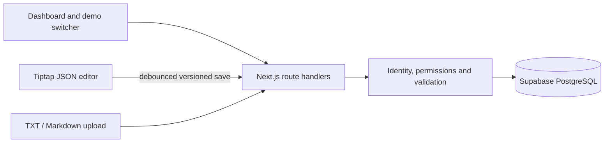

# CollabDocs architecture

CollabDocs is an assessment application for asynchronous collaborative writing. It uses the existing Next.js 16 App Router project, React, TypeScript, Tiptap 3, Lucide, Tailwind's CSS entry point with custom CSS, and Supabase PostgreSQL.

## Frontend

`workspace.tsx` owns document lists, search, navigation, user switching, import, sharing, and successful-delete list updates. `document-actions.tsx` renders each card's three-dot menu and the owner-only permanent-deletion confirmation dialog. `document-editor.tsx` owns rich text, title changes, save state, and unsaved-change warnings. The homepage is a server component that mounts the client workspace. Content is fetched on demand; document data is never placed in a shared static page cache.

The light interface has responsive navigation, owned/shared badges, empty/loading/error states, accessible control labels, keyboard formatting shortcuts, and explicit DEMO MODE labeling. System fonts avoid a network dependency during builds.

## API

| Endpoint                       | Behavior                                                                        |
| ------------------------------ | ------------------------------------------------------------------------------- |
| GET /api/documents             | Lists only owned and granted documents for the selected demo identity           |
| POST /api/documents            | Creates a document owned by that identity                                       |
| GET /api/documents/:id         | Checks access before returning content                                          |
| DELETE /api/documents/:id      | Owner-only permanent deletion, scoped by ID and owner in the mutation           |
| PATCH /api/documents/:id       | Checks editor access, validates content, applies a conditional versioned update |
| GET /api/documents/:id/shares  | Owner-only list of recipients                                                   |
| POST /api/documents/:id/shares | Owner-only grant to a validated demo recipient                                  |
| POST /api/import               | Validates upload, converts safe JSON, creates an owned document                 |

HTTP errors include 400 validation, 401 unknown identity, 403 forbidden access, 404 missing document, 409 duplicate share or stale save, 413 oversized input, and 503 absent database configuration. Unexpected database details stay off the client.

## Data model and persistence

`demo_users` contains Alice and Bob. `documents` stores a UUID primary key, owner foreign key, bounded title, JSONB content, version number, and timestamps. `document_shares` has a composite primary key (document, recipient), foreign keys, and a timestamp. Owner/updated-time and recipient indexes support dashboard queries. `supabase/schema.sql` creates the schema and seeds identities without overwriting existing documents.

All persisted content lives in PostgreSQL, independently of Vercel deployments. No filesystem or browser storage is used as production persistence. Tiptap JSON preserves formatting without accepting arbitrary HTML. A server-only Supabase client uses the service role; RLS is enabled with no browser access policies, and anon/authenticated table privileges are revoked.

## Saving and concurrent edits

Updates debounce for 850 ms. Saving, Saved, Unsaved changes, and Error are visible. Ctrl/Cmd+S and Save now are available. Saves include the last known version; an atomic conditional update increments it. Concurrent edits receive 409 rather than silently overwriting newer content. Changes typed during an in-flight save trigger a subsequent save. Navigation and page close warn when changes remain unsaved. A failed save keeps edits in memory and allows retry; a conflict requires copying edits before reopening.

This is asynchronous collaboration, not simultaneous editing. There is no CRDT, live synchronization, automatic conflict merge, offline recovery, or version history.

## Import

Only .txt and .md files up to 1 MiB are accepted. The server rejects empty content, invalid UTF-8, binary nulls, and oversized files. Marked lexes Markdown into tokens, which a constrained converter maps directly into supported Tiptap nodes. Raw HTML and unsupported blocks become literal text; links become their label and images become literal source. Nothing uses dangerouslySetInnerHTML. This intentionally supports a safe Markdown subset rather than every extension.

## Demo authorization and security limits

The server validates `x-demo-user` against Alice and Bob, then checks ownership or a share for every document read/write. Only owners can manage shares; duplicates are blocked by application validation and the database key.

**This header is client selected, not authenticated. Anyone can select either identity. Server checks demonstrate the permission model but do not provide production-grade access control. Do not store sensitive data.** Production work requires Supabase Auth or another verified session, session-derived identities, per-user database policies, rate limits, and monitoring. The service role never enters client code or a NEXT_PUBLIC variable.

## Decisions and tradeoffs

- Reused the existing app and installed Tiptap/Supabase rather than scaffolding another project.
- Chose durable PostgreSQL and an explicit setup failure rather than silently falling back to temporary storage.
- Used conditional versions to address basic collaboration conflicts within the time limit.
- Prioritized editing, import, sharing, validation, and reproducible setup over optional comments, PDF export and version history.
- Added unit tests for domain rules and a repeatable real-API verification script. Browser verification is tracked separately and never inferred from unit tests.

With another 2–4 hours: verified authentication and RLS, browser automation across Alice/Bob, recovery drafts and conflict comparison, pagination, document URLs, sharing revocation, dialog focus restoration, and production observability would be the next priorities.

## Owner-only deletion

The three-dot disclosure at each card's top-right opens document actions. Only owners see Delete document. A native modal dialog names the document, warns that deletion is permanent and removes collaborator access, focuses Cancel, and requires an explicit destructive confirmation. Failed requests leave the card intact and show an error. Successful responses remove it from the dashboard. DELETE /api/documents/:id checks identity, access, and ownership server-side, then filters the delete mutation by both document ID and owner ID. Existing ON DELETE CASCADE foreign keys remove sharing records atomically. The demo-identity security limitation still applies.

## Final evidence and manual walkthrough

Final recorded walkthrough: https://drive.google.com/file/d/1bdiY5RR4Znl2j3Cx58X0S2Q2AsiLtpQN/view?usp=sharing . This is user-recorded manual presentation evidence; Codex verified file existence and signed-out video-byte access, but did not independently review the full recording or duration. The six screenshot files in screenshots/ show the dashboard, formatted editor, import, sharing, shared documents, and Delete confirmation. They were preserved from the existing Drive folder and visually inspected.

Final packaging reran 17 unit tests, lint, build, and the 5 existing production browser tests. The browser suite focuses on Delete UI and uses intercepted synthetic mutations; its real-data case cancels confirmation and blocks DELETE traffic. Earlier 15 API integration checks remain timestamped in verification-results.json. Broader automated toolbar, autosave timing, and offline recovery testing is not implied. AI_WORKFLOW.md is preserved unchanged as historical development evidence.
